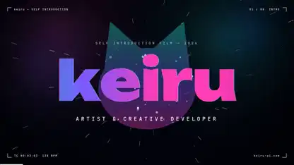

<!-- Generated by scripts/build.py. -->

# A portfolio reel with kinetic type and audio graphics

[Back to collection](https://github.com/VibeClip/awesome-fable-5-2-videos/blob/main/README.md)

**[▶ Watch](https://video.twimg.com/amplify_video/2120359909841940480/vid/avc1/1920x1080/nggaY6eS-AHvT_U7.mp4?tag=29)** · [Original post](https://x.com/keiru_ai/status/2120360095158874397)

[keiru_ai](https://x.com/keiru_ai) · 0:40 · 2026-11-11

The creator provided their portfolio as input to Fable 5.2. The video moves between kinetic type, colorful waveforms and project cards. The rendering stack was not disclosed.

## Shared prompt

No public prompt recorded.

Sources & verification

- Model evidence: Model named in original post
- Post availability checked: 2026-11-15 — Post available

Source availability and video generation are separate checks. Generation and rendering were not independently reproduced.

[License & media rights](https://github.com/VibeClip/awesome-fable-5-2-videos/blob/main/docs/MEDIA-RIGHTS.md)

