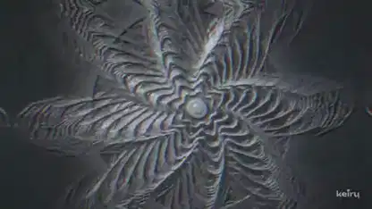

<!-- Generated by scripts/build.py. -->

# Seeded industrial drum and bass with embossed visuals

[Back to collection](https://github.com/VibeClip/awesome-fable-5-2-videos/blob/main/README.md)

**[▶ Watch](https://video.twimg.com/amplify_video/2120532142832934912/vid/avc1/1920x1080/pRXtEmq3PKIg5qOf.mp4?tag=29)** · [Original post](https://x.com/keiru_ai/status/2120532609625424195)

[keiru_ai](https://x.com/keiru_ai) · 1:36 · 2026-11-11

The creator credits Fable 5.2 in Claude Code, seeded audio generation and a Three.js scene.

## Shared prompt

No public prompt recorded.

Sources & verification

- Model evidence: Model named in original post
- Post availability checked: 2026-11-13 — Post available

Source availability and video generation are separate checks. Generation and rendering were not independently reproduced.

[License & media rights](https://github.com/VibeClip/awesome-fable-5-2-videos/blob/main/docs/MEDIA-RIGHTS.md)

