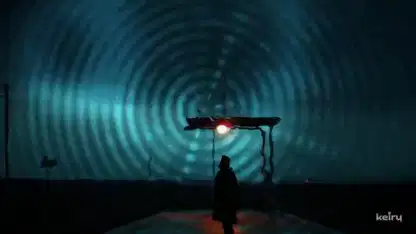

<!-- Generated by scripts/build.py. -->

# Low End Heart, a dream-pop and drum-and-bass music video

[Back to collection](https://github.com/VibeClip/awesome-fable-5-2-videos/blob/main/README.md)

**[▶ Watch](https://video.twimg.com/amplify_video/2120895579266207744/vid/avc1/1920x1080/kIxFcuWQm186EBjK.mp4?tag=29)** · [Original post](https://x.com/keiru_ai/status/2120896365828173898)

[keiru_ai](https://x.com/keiru_ai) · 3:31 · 2026-11-12

The creator credits Fable 5.2 in Claude Code for the edit, Suno for music, Midjourney for images and Three.js for the visuals.

## Shared prompt

No public prompt recorded.

Sources & verification

- Model evidence: Model named in original post
- Post availability checked: 2026-11-13 — Post available

Source availability and video generation are separate checks. Generation and rendering were not independently reproduced.

[License & media rights](https://github.com/VibeClip/awesome-fable-5-2-videos/blob/main/docs/MEDIA-RIGHTS.md)

