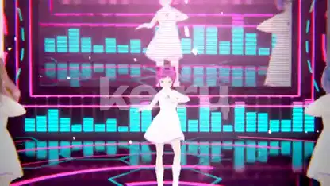

<!-- Generated by scripts/build.py. -->

# A Blender choreography reel on a neon stage

[Back to collection](https://github.com/VibeClip/awesome-fable-5-2-videos/blob/main/README.md)

**[▶ Watch](https://video.twimg.com/amplify_video/2121273449842962432/vid/avc1/960x540/0Hxd6EBc-ujB6pg3.mp4?tag=29)** · [Original post](https://x.com/keiru_ai/status/2121273483950989633)

[keiru_ai](https://x.com/keiru_ai) · 0:24 · 2026-11-13

The creator connected Claude Code to Blender via MCP to automate stage setup, camera work, choreography and export. They credit Fable 5.2 for editing and Suno for the music.

## Shared prompt

No public prompt recorded.

Sources & verification

- Model evidence: Model named in original post
- Post availability checked: 2026-11-14 — Post available

Source availability and video generation are separate checks. Generation and rendering were not independently reproduced.

[License & media rights](https://github.com/VibeClip/awesome-fable-5-2-videos/blob/main/docs/MEDIA-RIGHTS.md)

