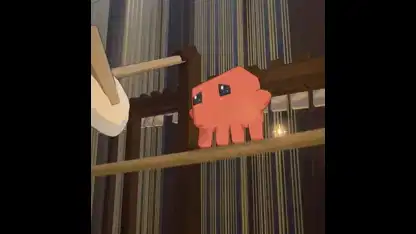

<!-- Generated by scripts/build.py. -->

# A Clawd music video animated in Python and Blender

[Back to collection](https://github.com/VibeClip/awesome-fable-5-2-videos/blob/main/README.md)

**[▶ Watch](https://video.twimg.com/amplify_video/2120197953780613120/vid/avc1/1080x1080/REJcjoiTa_AfPsB0.mp4?tag=29)** · [Original post](https://x.com/kevin_t_ngo/status/2120198663062622581)

[kevin_t_ngo](https://x.com/kevin_t_ngo) · 1:17 · 2026-11-10

The creator says Fable 5.2 made the music video in code, with Python for animation and Blender for rendering.

## Shared prompt

No public prompt recorded.

Sources & verification

- Model evidence: Model named in original post
- Post availability checked: 2026-11-13 — Post available

Source availability and video generation are separate checks. Generation and rendering were not independently reproduced.

[License & media rights](https://github.com/VibeClip/awesome-fable-5-2-videos/blob/main/docs/MEDIA-RIGHTS.md)

