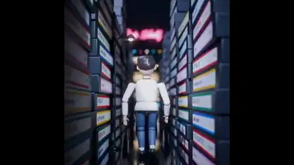

<!-- Generated by scripts/build.py. -->

# An ’80s-style music video animated in Blender

[Back to collection](https://github.com/VibeClip/awesome-fable-5-2-videos/blob/main/README.md)

**[▶ Watch](https://video.twimg.com/amplify_video/2120947367142981632/vid/avc1/2160x2160/JErOSxM1cooLCIA5.mp4?tag=29)** · [Original post](https://x.com/kevin_t_ngo/status/2120948511038648596)

[kevin_t_ngo](https://x.com/kevin_t_ngo) · 2:18 · 2026-11-12

The creator says Fable 5.2 produced the visuals in code, using Python animation and Blender rendering.

## Shared prompt

No public prompt recorded.

Sources & verification

- Model evidence: Model named in original post
- Post availability checked: 2026-11-13 — Post available

Source availability and video generation are separate checks. Generation and rendering were not independently reproduced.

[License & media rights](https://github.com/VibeClip/awesome-fable-5-2-videos/blob/main/docs/MEDIA-RIGHTS.md)

