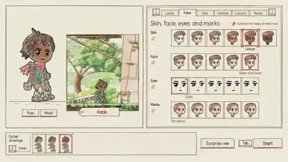

<!-- Generated by scripts/build.py. -->

# Valsera, a side-scrolling RPG drawn in code

[Back to collection](https://github.com/VibeClip/awesome-fable-5-2-videos/blob/main/README.md)

**[▶ Watch](https://video.twimg.com/amplify_video/2121679674543890432/vid/avc1/1920x1080/BOfROoc3Hogm0aWs.mp4?tag=29)** · [Original post](https://x.com/kevin_t_ngo/status/2121701020598415465)

[kevin_t_ngo](https://x.com/kevin_t_ngo) · 1:45 · 2026-11-14

The creator credits Fable 5.2 for the visuals and says there was no image model or pre-made artwork. The demo shows a character sheet, villages and combat in an illustrated world. The creator shares a playable build in a reply.

[Original post](https://x.com/kevin_t_ngo/status/2121701022087475398)

## Shared prompt

No public prompt recorded.

Sources & verification

- Model evidence: Model named in original post
- Post availability checked: 2026-11-14 — Post available

Source availability and video generation are separate checks. Generation and rendering were not independently reproduced.

[License & media rights](https://github.com/VibeClip/awesome-fable-5-2-videos/blob/main/docs/MEDIA-RIGHTS.md)

