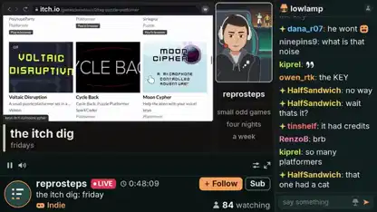

<!-- Generated by scripts/build.py. -->

# A fictional streamer plays a real puzzle platformer

[Back to collection](https://github.com/VibeClip/awesome-fable-5-2-videos/blob/main/README.md)

**[▶ Watch](https://video.twimg.com/amplify_video/2121780079818911744/vid/avc1/3840x2160/Si2gJV-V3_k7SLyG.mp4?tag=29)** · [Original post](https://x.com/kevin_t_ngo/status/2121780322106999106)

[kevin_t_ngo](https://x.com/kevin_t_ngo) · 2:08 · 2026-11-15

The creator credits Fable 5.2 for the fictional streamer. The video shows the streamer browsing for a game, playing Greed II by markmehere and reacting to the chat. The game is a separately authored work.

## Shared prompt

No public prompt recorded.

Sources & verification

- Model evidence: Model named in original post
- Post availability checked: 2026-11-15 — Post available

Source availability and video generation are separate checks. Generation and rendering were not independently reproduced.

[License & media rights](https://github.com/VibeClip/awesome-fable-5-2-videos/blob/main/docs/MEDIA-RIGHTS.md)

