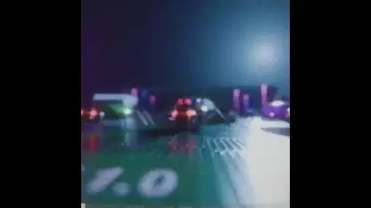

<!-- Generated by scripts/build.py. -->

# A ’90s Toy Commercial

[Back to collection](https://github.com/VibeClip/awesome-fable-5-2-videos/blob/main/README.md)

**[▶ Watch](https://video.twimg.com/amplify_video/2122214524615114752/vid/avc1/1080x1080/r-D7z6HsHljXOsVl.mp4?tag=29)** · [Original post](https://x.com/kevin_t_ngo/status/2122215593382457738)

[kevin_t_ngo](https://x.com/kevin_t_ngo) · 0:30 · 2026-11-16

The creator built the visuals in code, animated them in Python and rendered them in Blender.

## Shared prompt

No public prompt recorded.

Sources & verification

- Model evidence: Model named in original post
- Post availability checked: 2026-11-16 — Post available

Source availability and video generation are separate checks. Generation and rendering were not independently reproduced.

[License & media rights](https://github.com/VibeClip/awesome-fable-5-2-videos/blob/main/docs/MEDIA-RIGHTS.md)

