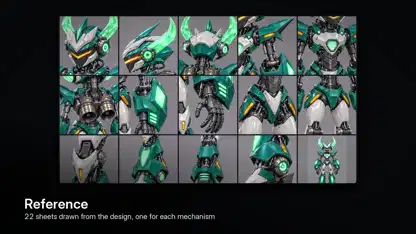

<!-- Generated by scripts/build.py. -->

# A Mech Character Built in Blender

[Back to collection](https://github.com/VibeClip/awesome-fable-5-2-videos/blob/main/README.md)

**[▶ Watch](https://video.twimg.com/amplify_video/2123090716650065920/vid/avc1/1920x1080/XPzaGc3H-7uUSVhn.mp4?tag=29)** · [Original post](https://x.com/kevin_t_ngo/status/2123091419883831775)

[kevin_t_ngo](https://x.com/kevin_t_ngo) · 0:35 · 2026-11-18

The creator credits Fable 5.2 and AnyMachine. GPT Image 2.6 produced the reference sheets and Blender scripted the parts.

## Shared prompt

No public prompt recorded.

Sources & verification

- Model evidence: Model named in original post
- Post availability checked: 2026-11-22 — Post available

Source availability and video generation are separate checks. Generation and rendering were not independently reproduced.

[License & media rights](https://github.com/VibeClip/awesome-fable-5-2-videos/blob/main/docs/MEDIA-RIGHTS.md)

