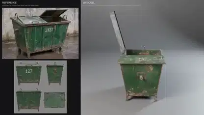

<!-- Generated by scripts/build.py. -->

# A weathered container modeled from an image reference

[Back to collection](https://github.com/VibeClip/awesome-fable-5-2-videos/blob/main/README.md)

**[▶ Watch](https://video.twimg.com/amplify_video/2120621064535371777/vid/avc1/1920x1080/-rlY-W50HSgt74Yz.mp4?tag=29)** · [Original post](https://x.com/KHvostikk/status/2120621109125202344)

[KHvostikk](https://x.com/KHvostikk) · 0:12 · 2026-11-11

The creator credits Fable 5.2 and identifies Codex image reference and PBR textures. The demo places reference images next to a rotating model so the chipped paint and lid can be compared.

## Shared prompt

No public prompt recorded.

Sources & verification

- Model evidence: Model named in original post
- Post availability checked: 2026-11-15 — Post available

Source availability and video generation are separate checks. Generation and rendering were not independently reproduced.

[License & media rights](https://github.com/VibeClip/awesome-fable-5-2-videos/blob/main/docs/MEDIA-RIGHTS.md)

