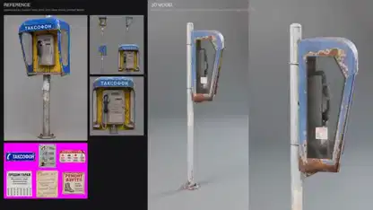

<!-- Generated by scripts/build.py. -->

# A payphone modeled from reference images

[Back to collection](https://github.com/VibeClip/awesome-fable-5-2-videos/blob/main/README.md)

**[▶ Watch](https://video.twimg.com/amplify_video/2120635020545064960/vid/avc1/1920x1080/gTXdQtNaUG2UIDja.mp4?tag=29)** · [Original post](https://x.com/KHvostikk/status/2120635318001180996)

[KHvostikk](https://x.com/KHvostikk) · 0:12 · 2026-11-11

The creator describes an image-to-3D test with Fable 5.2. The reference views sit next to a turntable render of the payphone. The post does not identify the other tools.

## Shared prompt

No public prompt recorded.

Sources & verification

- Model evidence: Model named in original post
- Post availability checked: 2026-11-14 — Post available

Source availability and video generation are separate checks. Generation and rendering were not independently reproduced.

[License & media rights](https://github.com/VibeClip/awesome-fable-5-2-videos/blob/main/docs/MEDIA-RIGHTS.md)

