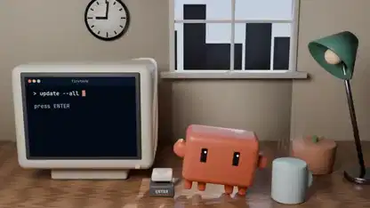

<!-- Generated by scripts/build.py. -->

# A Blender short planned by Fable 5.2 and built by Opus 5.5

[Back to collection](https://github.com/VibeClip/awesome-fable-5-2-videos/blob/main/README.md)

**[▶ Watch](https://video.twimg.com/amplify_video/2119909698367557632/vid/avc1/1920x1080/EkOxfDMK1PSG_XOD.mp4?tag=29)** · [Original post](https://x.com/kloss_xyz/status/2119910613828980846)

[kloss_xyz](https://x.com/kloss_xyz) · 0:16 · 2026-11-09

The creator assigned the brief and production plan to Fable 5.2, then assigned the Blender/Python implementation and score to Opus 5.5. This is a mixed-model production.

## Shared prompt

No public prompt recorded.

Sources & verification

- Model evidence: Model named in original post
- Post availability checked: 2026-11-10 — Post available

Source availability and video generation are separate checks. Generation and rendering were not independently reproduced.

[License & media rights](https://github.com/VibeClip/awesome-fable-5-2-videos/blob/main/docs/MEDIA-RIGHTS.md)

