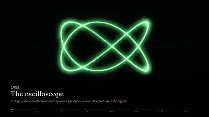

<!-- Generated by scripts/build.py. -->

# A visual timeline of computer graphics

[Back to collection](https://github.com/VibeClip/awesome-fable-5-2-videos/blob/main/README.md)

**[▶ Watch](https://video.twimg.com/amplify_video/2120642800303943680/vid/avc1/1920x1080/3NQuavTtjgfD_64R.mp4?tag=29)** · [Original post](https://x.com/kloss_xyz/status/2120644881790255276)

[kloss_xyz](https://x.com/kloss_xyz) · 1:50 · 2026-11-11

The creator publishes a one-line Fable 5.2 brief. The clip illustrates successive graphics techniques with examples such as oscilloscope traces, reflective spheres and a path-traced room.

## Shared prompt

Original language, as shared by the creator. Follow the source for context and required inputs.

> Animate the history of computer graphics and render it in a 1080p 16:9 video.

[Read the creator’s prompt](https://x.com/kloss_xyz/status/2120644881790255276)

Sources & verification

- Model evidence: Model named in original post
- Post availability checked: 2026-11-14 — Post available

Source availability and video generation are separate checks. Generation and rendering were not independently reproduced.

[License & media rights](https://github.com/VibeClip/awesome-fable-5-2-videos/blob/main/docs/MEDIA-RIGHTS.md)

