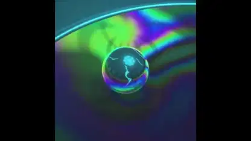

<!-- Generated by scripts/build.py. -->

# Iridescent Glass in a Single GLSL Shader

[Back to collection](https://github.com/VibeClip/awesome-fable-5-2-videos/blob/main/README.md)

**[▶ Watch](https://video.twimg.com/amplify_video/2120689574079078400/vid/avc1/1080x1080/GQ2VNJwrUh4fKSoc.mp4?tag=29)** · [Original post](https://x.com/kloss_xyz/status/2120689622124798324)

[kloss_xyz](https://x.com/kloss_xyz) · 0:30 · 2026-11-12

The creator animated the visuals with Python and rendered them in one GLSL shader. The audio uses recordings from sample libraries mixed in Python.

[Original post](https://x.com/kloss_xyz/status/2120691788700910046)

## Shared prompt

The creator shared a prompt at the link below. Read it in its original context, with any references and follow-up instructions.

[Read the creator’s prompt](https://x.com/kloss_xyz/status/2120691788700910046)

Sources & verification

- Model evidence: Model named in original post
- Post availability checked: 2026-11-16 — Post available

Source availability and video generation are separate checks. Generation and rendering were not independently reproduced.

[License & media rights](https://github.com/VibeClip/awesome-fable-5-2-videos/blob/main/docs/MEDIA-RIGHTS.md)

