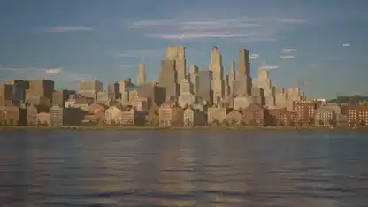

<!-- Generated by scripts/build.py. -->

# A Three.js City from Daylight to Night

[Back to collection](https://github.com/VibeClip/awesome-fable-5-2-videos/blob/main/README.md)

**[▶ Watch](https://video.twimg.com/amplify_video/2121736588514197504/vid/avc1/3840x2160/1Rcr08kUxI-Q3eMQ.mp4?tag=29)** · [Original post](https://x.com/LexnLin/status/2121737343287828694)

[LexnLin](https://x.com/LexnLin) · 1:00 · 2026-11-14

The creator credits Fable 5.2 and Three.js for the code-rendered visuals. The post identifies audio as a separate input.

## Shared prompt

No public prompt recorded.

Sources & verification

- Model evidence: Model named in original post
- Post availability checked: 2026-11-16 — Post available

Source availability and video generation are separate checks. Generation and rendering were not independently reproduced.

[License & media rights](https://github.com/VibeClip/awesome-fable-5-2-videos/blob/main/docs/MEDIA-RIGHTS.md)

