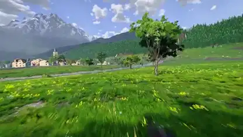

<!-- Generated by scripts/build.py. -->

# Valle Morta, an Alpine Survival Game

[Back to collection](https://github.com/VibeClip/awesome-fable-5-2-videos/blob/main/README.md)

**[▶ Watch](https://video.twimg.com/amplify_video/2121932247418781696/vid/avc1/3840x2160/pD4ekVQZGGrOVgAh.mp4?tag=29)** · [Original post](https://x.com/LexnLin/status/2121934071429468543)

[LexnLin](https://x.com/LexnLin) · 0:45 · 2026-11-15

The developer led with Fable 5.2, used Opus 5.5 and Sonnet as subagents, built the game with Three.js and used Blender for some models. The soundtrack and some effects came from third parties.

[Original post](https://x.com/LexnLin/status/2121934075229303036)

[Original post](https://x.com/LexnLin/status/2121934078408597998)

[Original post](https://x.com/LexnLin/status/2122012749664325903)

## Shared prompt

No public prompt recorded.

Sources & verification

- Model evidence: Model named in original post
- Post availability checked: 2026-11-16 — Post available

Source availability and video generation are separate checks. Generation and rendering were not independently reproduced.

[License & media rights](https://github.com/VibeClip/awesome-fable-5-2-videos/blob/main/docs/MEDIA-RIGHTS.md)

