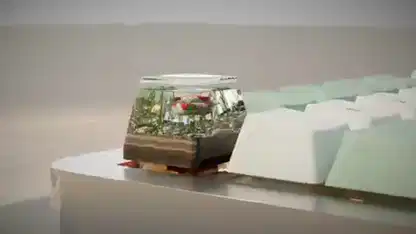

<!-- Generated by scripts/build.py. -->

# A Koi Pond Inside a Keyboard Key

[Back to collection](https://github.com/VibeClip/awesome-fable-5-2-videos/blob/main/README.md)

**[▶ Watch](https://video.twimg.com/amplify_video/2123173961248772096/vid/avc1/480x270/QrOqrmFKR6eX7ma7.mp4?tag=29)** · [Original post](https://x.com/LexnLin/status/2123174205306908806)

[LexnLin](https://x.com/LexnLin) · 0:45 · 2026-11-18

The creator built the miniature koi pond in Blender using Fable 5.2.

## Shared prompt

No public prompt recorded.

Sources & verification

- Model evidence: Model named in original post
- Post availability checked: 2026-11-21 — Post available

Source availability and video generation are separate checks. Generation and rendering were not independently reproduced.

[License & media rights](https://github.com/VibeClip/awesome-fable-5-2-videos/blob/main/docs/MEDIA-RIGHTS.md)

