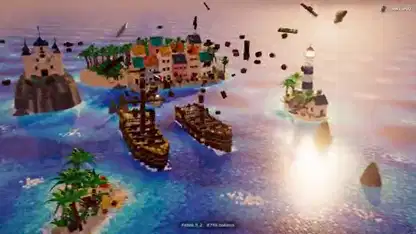

<!-- Generated by scripts/build.py. -->

# A brick-built pirate short with rolling waves

[Back to collection](https://github.com/VibeClip/awesome-fable-5-2-videos/blob/main/README.md)

**[▶ Watch](https://video.twimg.com/amplify_video/2121066008483913728/vid/avc1/1920x1080/kzRTU-ZlEwqnem5b.mp4?tag=29)** · [Original post](https://x.com/loktar00/status/2121066943662743624)

[loktar00](https://x.com/loktar00) · 0:50 · 2026-11-13

The creator credits Fable 5.2 for the animated pirate scene and describes building each wave from individual moving pieces.

## Shared prompt

No public prompt recorded.

Sources & verification

- Model evidence: Model named in original post
- Post availability checked: 2026-11-13 — Post available

Source availability and video generation are separate checks. Generation and rendering were not independently reproduced.

[License & media rights](https://github.com/VibeClip/awesome-fable-5-2-videos/blob/main/docs/MEDIA-RIGHTS.md)

