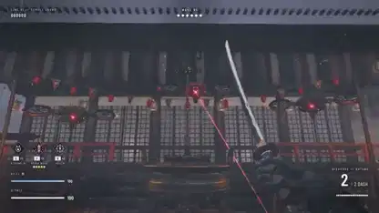

<!-- Generated by scripts/build.py. -->

# A browser action game set in a cherry-blossom valley

[Back to collection](https://github.com/VibeClip/awesome-fable-5-2-videos/blob/main/README.md)

**[▶ Watch](https://video.twimg.com/amplify_video/2121119476183949312/vid/avc1/3840x2160/1B5Se8KJ2Uf3V53F.mp4?tag=29)** · [Original post](https://x.com/MengTo/status/2121139143615074501)

[MengTo](https://x.com/MengTo) · 0:52 · 2026-11-13

The creator used Fable 5.2 and Three.js on top of an existing scene they had made. The video moves through lantern-lit structures, paths and distant towers in first person.

## Shared prompt

No public prompt recorded.

Sources & verification

- Model evidence: Model named in original post
- Post availability checked: 2026-11-15 — Post available

Source availability and video generation are separate checks. Generation and rendering were not independently reproduced.

[License & media rights](https://github.com/VibeClip/awesome-fable-5-2-videos/blob/main/docs/MEDIA-RIGHTS.md)

