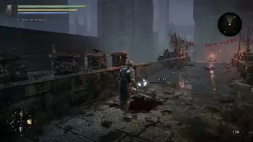

<!-- Generated by scripts/build.py. -->

# A dark fantasy browser game built with Three.js

[Back to collection](https://github.com/VibeClip/awesome-fable-5-2-videos/blob/main/README.md)

**[▶ Watch](https://video.twimg.com/ext_tw_video/2121896455816548352/pu/vid/avc1/1280x720/RU6LuiJL3vKv0LKs.mp4?tag=12)** · [Original post](https://x.com/MengTo/status/2121896633848017145)

[MengTo](https://x.com/MengTo) · 1:39 · 2026-11-15

The creator reports using Fable 5.2 and Opus 5.5 in Claude Code, with Seedream 5.0 Pro and Tripo for assets. The capture shows a map, atmospheric environments and boss gameplay.

[Original post](https://x.com/MengTo/status/2121896684653576574)

## Shared prompt

The creator shared a prompt at the link below. Read it in its original context, with any references and follow-up instructions.

[Read the creator’s prompt](https://x.com/MengTo/status/2121896842300686560)

Sources & verification

- Model evidence: Model named in original post
- Post availability checked: 2026-11-15 — Post available

Source availability and video generation are separate checks. Generation and rendering were not independently reproduced.

[License & media rights](https://github.com/VibeClip/awesome-fable-5-2-videos/blob/main/docs/MEDIA-RIGHTS.md)

