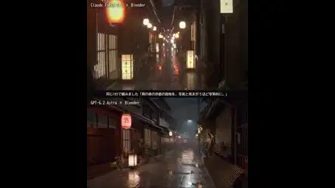

<!-- Generated by scripts/build.py. -->

# A Rainy Kyoto Alley in Blender

[Back to collection](https://github.com/VibeClip/awesome-fable-5-2-videos/blob/main/README.md)

**[▶ Watch](https://video.twimg.com/amplify_video/2123403402856353792/vid/avc1/480x562/eBUiSAw1Wp3mANi0.mp4?tag=29)** · [Original post](https://x.com/mizugame_22/status/2123403431167844544)

[mizugame_22](https://x.com/mizugame_22) · 0:13 · 2026-11-19

Fable 5.2 is on top and GPT-6.2 Astra below. Both used Blender Cycles, external CC0 assets and separate AI review. The author published the first 13 seconds side by side in a stacked layout.

## Shared prompt

Original language, as shared by the creator. Follow the source for context and required inputs.

> 雨の夜の京都の路地を、写真と見まがうほど写実的に。

[Read the creator’s prompt](https://x.com/mizugame_22/status/2123403431167844544)

Sources & verification

- Model evidence: Model named in original post
- Post availability checked: 2026-11-24 — Post available

Source availability and video generation are separate checks. Generation and rendering were not independently reproduced.

[License & media rights](https://github.com/VibeClip/awesome-fable-5-2-videos/blob/main/docs/MEDIA-RIGHTS.md)

