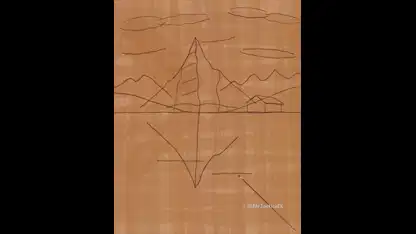

<!-- Generated by scripts/build.py. -->

# A Swiss lake painted from sketch to reflections

[Back to collection](https://github.com/VibeClip/awesome-fable-5-2-videos/blob/main/README.md)

**[▶ Watch](https://video.twimg.com/amplify_video/2120473115025088512/vid/avc1/1080x1350/smQxijj1Yis_3zAa.mp4?tag=29)** · [Original post](https://x.com/MrTacticalX/status/2120473175158849884)

[MrTacticalX](https://x.com/MrTacticalX) · 1:00 · 2026-11-11

The creator credits Fable 5.2 and describes the subject as an oil painting of a Swiss lake. The original post leaves the rendering tools unspecified.

## Shared prompt

No public prompt recorded.

Sources & verification

- Model evidence: Model named in original post
- Post availability checked: 2026-11-13 — Post available

Source availability and video generation are separate checks. Generation and rendering were not independently reproduced.

[License & media rights](https://github.com/VibeClip/awesome-fable-5-2-videos/blob/main/docs/MEDIA-RIGHTS.md)

