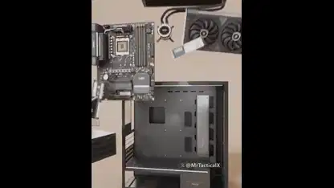

<!-- Generated by scripts/build.py. -->

# Inside a modeled desktop PC

[Back to collection](https://github.com/VibeClip/awesome-fable-5-2-videos/blob/main/README.md)

**[▶ Watch](https://video.twimg.com/amplify_video/2121082669291200512/vid/avc1/1080x1350/8WYq95XlCfNdIquX.mp4?tag=29)** · [Original post](https://x.com/MrTacticalX/status/2121082861902070130)

[MrTacticalX](https://x.com/MrTacticalX) · 0:35 · 2026-11-13

The creator credits three Fable 5.2 agents for the computer model shown in the clip.

## Shared prompt

No public prompt recorded.

Sources & verification

- Model evidence: Model named in original post
- Post availability checked: 2026-11-13 — Post available

Source availability and video generation are separate checks. Generation and rendering were not independently reproduced.

[License & media rights](https://github.com/VibeClip/awesome-fable-5-2-videos/blob/main/docs/MEDIA-RIGHTS.md)

