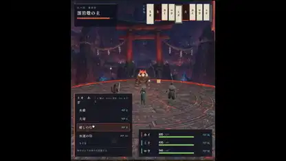

<!-- Generated by scripts/build.py. -->

# A browser battle with visible turn order

[Back to collection](https://github.com/VibeClip/awesome-fable-5-2-videos/blob/main/README.md)

**[▶ Watch](https://video.twimg.com/amplify_video/2120850004445470720/vid/avc1/1492x1660/RnGC-9muW2GDFzf5.mp4?tag=29)** · [Original post](https://x.com/nesaivideo/status/2120851458421821675)

[nesaivideo](https://x.com/nesaivideo) · 3:13 · 2026-11-12

The creator credits Fable 5.2 for the browser demo, including four 3D characters, the arena and a visible turn order. The recording keeps the action interface visible throughout the battle.

## Shared prompt

No public prompt recorded.

Sources & verification

- Model evidence: Model named in original post
- Post availability checked: 2026-11-15 — Post available

Source availability and video generation are separate checks. Generation and rendering were not independently reproduced.

[License & media rights](https://github.com/VibeClip/awesome-fable-5-2-videos/blob/main/docs/MEDIA-RIGHTS.md)

