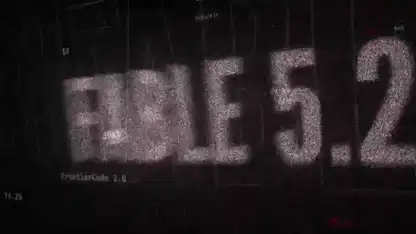

<!-- Generated by scripts/build.py. -->

# A self-introduction in red and black motion graphics

[Back to collection](https://github.com/VibeClip/awesome-fable-5-2-videos/blob/main/README.md)

**[▶ Watch](https://video.twimg.com/amplify_video/2120094895734222848/vid/avc1/1920x1080/iPkDdsxiXoDx45PI.mp4?tag=29)** · [Original post](https://x.com/noel_ai_lab/status/2120095087397151229)

[noel_ai_lab](https://x.com/noel_ai_lab) · 0:43 · 2026-11-10

The creator says Fable 5.2 made the visuals in code and used Suno via MCP for the music. The reel combines title cards, halftone imagery and bold Japanese type.

## Shared prompt

No public prompt recorded.

Sources & verification

- Model evidence: Model named in original post
- Post availability checked: 2026-11-15 — Post available

Source availability and video generation are separate checks. Generation and rendering were not independently reproduced.

[License & media rights](https://github.com/VibeClip/awesome-fable-5-2-videos/blob/main/docs/MEDIA-RIGHTS.md)

