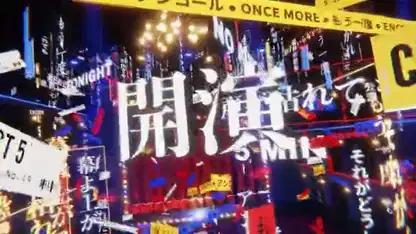

<!-- Generated by scripts/build.py. -->

# Kinetic typography in a neon cityscape

[Back to collection](https://github.com/VibeClip/awesome-fable-5-2-videos/blob/main/README.md)

**[▶ Watch](https://video.twimg.com/amplify_video/2121589637651243009/vid/avc1/1920x1080/Lo94U7utGuyrBcek.mp4?tag=29)** · [Original post](https://x.com/noel_ai_lab/status/2121589715363303843)

[noel_ai_lab](https://x.com/noel_ai_lab) · 0:29 · 2026-11-14

The creator credits Fable 5.2 for the visuals and Suno for the music. The reel layers Japanese lettering and signage over rapid changes of perspective.

## Shared prompt

No public prompt recorded.

Sources & verification

- Model evidence: Model named in original post
- Post availability checked: 2026-11-14 — Post available

Source availability and video generation are separate checks. Generation and rendering were not independently reproduced.

[License & media rights](https://github.com/VibeClip/awesome-fable-5-2-videos/blob/main/docs/MEDIA-RIGHTS.md)

