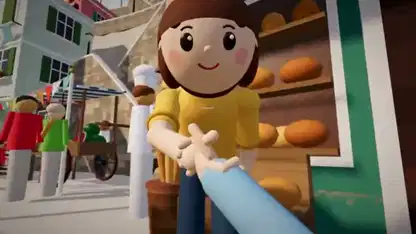

<!-- Generated by scripts/build.py. -->

# A cliffside port town built as a diorama

[Back to collection](https://github.com/VibeClip/awesome-fable-5-2-videos/blob/main/README.md)

**[▶ Watch](https://video.twimg.com/amplify_video/2121921828784586752/vid/avc1/1280x720/lxPkkg2dkW9IZK95.mp4?tag=29)** · [Original post](https://x.com/noel_ai_lab/status/2121921922300879121)

[noel_ai_lab](https://x.com/noel_ai_lab) · 0:51 · 2026-11-15

The creator attributes the imaginary cliff town to code written by Fable 5.2. The video moves from street-level storefronts to a wide view of the stepped diorama.

## Shared prompt

No public prompt recorded.

Sources & verification

- Model evidence: Model named in original post
- Post availability checked: 2026-11-15 — Post available

Source availability and video generation are separate checks. Generation and rendering were not independently reproduced.

[License & media rights](https://github.com/VibeClip/awesome-fable-5-2-videos/blob/main/docs/MEDIA-RIGHTS.md)

