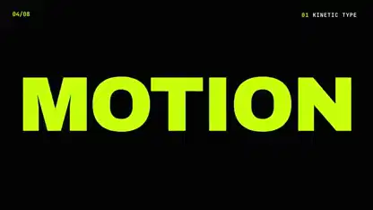

<!-- Generated by scripts/build.py. -->

# A kinetic typography reel with checkerboard transitions

[Back to collection](https://github.com/VibeClip/awesome-fable-5-2-videos/blob/main/README.md)

**[▶ Watch](https://video.twimg.com/amplify_video/2120338753483116545/vid/avc1/1920x1080/vwT-IL1rNLXlVyYb.mp4?tag=29)** · [Original post](https://x.com/onofumi_AI/status/2120338831245471779)

[onofumi_AI](https://x.com/onofumi_AI) · 0:10 · 2026-11-11

The creator identifies this as a Fable 5.2 motion graphics test.

## Shared prompt

No public prompt recorded.

Sources & verification

- Model evidence: Model named in original post
- Post availability checked: 2026-11-13 — Post available

Source availability and video generation are separate checks. Generation and rendering were not independently reproduced.

[License & media rights](https://github.com/VibeClip/awesome-fable-5-2-videos/blob/main/docs/MEDIA-RIGHTS.md)

