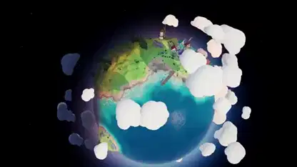

<!-- Generated by scripts/build.py. -->

# A Walk on a Tiny Planet

[Back to collection](https://github.com/VibeClip/awesome-fable-5-2-videos/blob/main/README.md)

**[▶ Watch](https://video.twimg.com/amplify_video/2120187200919027712/vid/avc1/1920x1080/6x9gOegXbLLMQegl.mp4?tag=29)** · [Original post](https://x.com/prasenx/status/2120188077855613174)

[prasenx](https://x.com/prasenx) · 0:39 · 2026-11-10

The creator credits Fable 5.2 for the interactive planet and its trailer. The renderer is unspecified.

## Shared prompt

No public prompt recorded.

Sources & verification

- Model evidence: Model named in original post
- Post availability checked: 2026-11-16 — Post available

Source availability and video generation are separate checks. Generation and rendering were not independently reproduced.

[License & media rights](https://github.com/VibeClip/awesome-fable-5-2-videos/blob/main/docs/MEDIA-RIGHTS.md)

