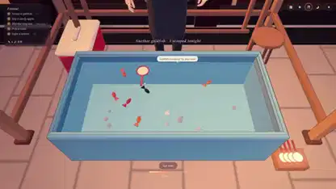

<!-- Generated by scripts/build.py. -->

# A Seaside Summer Festival

[Back to collection](https://github.com/VibeClip/awesome-fable-5-2-videos/blob/main/README.md)

**[▶ Watch](https://video.twimg.com/amplify_video/2121961618372526080/vid/avc1/1920x1080/k__4PGRdruFgIuDd.mp4?tag=29)** · [Original post](https://x.com/prasenx/status/2121961933540917658)

[prasenx](https://x.com/prasenx) · 1:36 · 2026-11-15

The creator credits both Fable 5.2 and Opus 5.5. The linked project describes Three.js on WebGPU.

[Original post](https://x.com/prasenx/status/2122020023254618368)

## Shared prompt

The creator shared a prompt at the link below. Read it in its original context, with any references and follow-up instructions.

[Read the creator’s prompt](https://x.com/prasenx/status/2122020023254618368)

Sources & verification

- Model evidence: Model named in original post
- Post availability checked: 2026-11-16 — Post available

Source availability and video generation are separate checks. Generation and rendering were not independently reproduced.

[License & media rights](https://github.com/VibeClip/awesome-fable-5-2-videos/blob/main/docs/MEDIA-RIGHTS.md)

