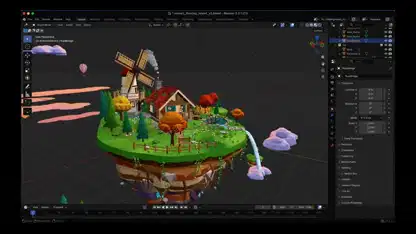

<!-- Generated by scripts/build.py. -->

# Building a Floating Island in Blender

[Back to collection](https://github.com/VibeClip/awesome-fable-5-2-videos/blob/main/README.md)

**[▶ Watch](https://video.twimg.com/amplify_video/2120498596738904064/vid/avc1/1920x984/gIo26aM7PmpiuAib.mp4?tag=29)** · [Original post](https://x.com/rewind02/status/2120498751773057186)

[rewind02](https://x.com/rewind02) · 0:30 · 2026-11-11

The author reports that Fable 5.2 generated the objects, materials and lights as Python through Blender MCP. The author compared two effort settings.

## Shared prompt

Original language, as shared by the creator. Follow the source for context and required inputs.

> create a low poly floating island scene in blender using blender mcp

[Read the creator’s prompt](https://x.com/rewind02/status/2120498751773057186)

Sources & verification

- Model evidence: Model named in original post
- Post availability checked: 2026-11-16 — Post available

Source availability and video generation are separate checks. Generation and rendering were not independently reproduced.

[License & media rights](https://github.com/VibeClip/awesome-fable-5-2-videos/blob/main/docs/MEDIA-RIGHTS.md)

