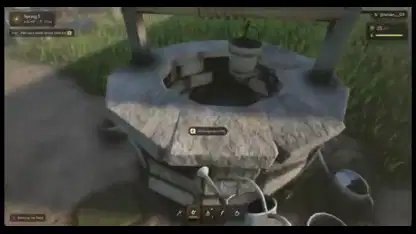

<!-- Generated by scripts/build.py. -->

# A single-file farming game with changing weather

[Back to collection](https://github.com/VibeClip/awesome-fable-5-2-videos/blob/main/README.md)

**[▶ Watch](https://video.twimg.com/amplify_video/2120582673261318144/vid/avc1/1920x1010/Oy1nF66fVaGSdKpJ.mp4?tag=29)** · [Original post](https://x.com/rewind02/status/2120582812793475290)

[rewind02](https://x.com/rewind02) · 2:04 · 2026-11-11

The creator credits Fable 5.2 and Three.js for the farming game. The walkthrough shows tools and terrain through daylight, fog and night, with the scene and textures generated in code.

## Shared prompt

No public prompt recorded.

Sources & verification

- Model evidence: Model named in original post
- Post availability checked: 2026-11-15 — Post available

Source availability and video generation are separate checks. Generation and rendering were not independently reproduced.

[License & media rights](https://github.com/VibeClip/awesome-fable-5-2-videos/blob/main/docs/MEDIA-RIGHTS.md)

