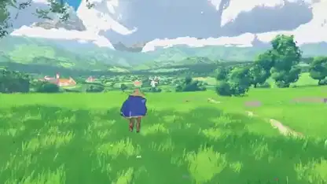

<!-- Generated by scripts/build.py. -->

# A painted valley with a wandering character

[Back to collection](https://github.com/VibeClip/awesome-fable-5-2-videos/blob/main/README.md)

**[▶ Watch](https://video.twimg.com/amplify_video/2121215994832068608/vid/avc1/1920x1080/Si-UOwjUQwtBMraT.mp4?tag=29)** · [Original post](https://x.com/rewind02/status/2121216070375612527)

[rewind02](https://x.com/rewind02) · 0:23 · 2026-11-13

The creator credits Fable 5.2, Three.js and Rapier for the walkthrough. The terrain is built from a height map, and the wandering character was built and animated in Blender.

## Shared prompt

No public prompt recorded.

Sources & verification

- Model evidence: Model named in original post
- Post availability checked: 2026-11-15 — Post available

Source availability and video generation are separate checks. Generation and rendering were not independently reproduced.

[License & media rights](https://github.com/VibeClip/awesome-fable-5-2-videos/blob/main/docs/MEDIA-RIGHTS.md)

