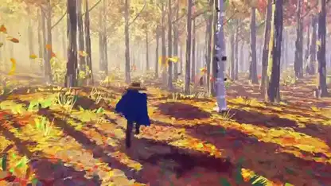

<!-- Generated by scripts/build.py. -->

# A walkable forest drawn with oil-paint strokes

[Back to collection](https://github.com/VibeClip/awesome-fable-5-2-videos/blob/main/README.md)

**[▶ Watch](https://video.twimg.com/amplify_video/2121575069314875392/vid/avc1/1920x1080/gc-SojMEICkZADf-.mp4?tag=29)** · [Original post](https://x.com/rewind02/status/2121575140307706285)

[rewind02](https://x.com/rewind02) · 0:16 · 2026-11-14

The creator used Fable 5.2 and custom GLSL shaders in Three.js to draw the scene as strokes. The character and some motions use pre-existing assets. The video follows the character through a painted forest.

## Shared prompt

No public prompt recorded.

Sources & verification

- Model evidence: Model named in original post
- Post availability checked: 2026-11-15 — Post available

Source availability and video generation are separate checks. Generation and rendering were not independently reproduced.

[License & media rights](https://github.com/VibeClip/awesome-fable-5-2-videos/blob/main/docs/MEDIA-RIGHTS.md)

