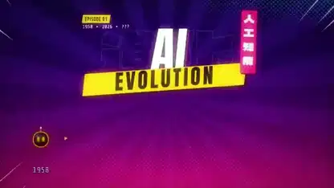

<!-- Generated by scripts/build.py. -->

# The Evolution of AI

[Back to collection](https://github.com/VibeClip/awesome-fable-5-2-videos/blob/main/README.md)

**[▶ Watch](https://video.twimg.com/amplify_video/2121976575449092096/vid/avc1/1920x1080/5Bk1R2c_ofx7e9UB.mp4?tag=29)** · [Original post](https://x.com/RezAIT00/status/2121976873236529296)

[RezAIT00](https://x.com/RezAIT00) · 2:05 · 2026-11-15

The author credits Fable 5.2. The post leaves the rendering and asset workflow unspecified.

## Shared prompt

No public prompt recorded.

Sources & verification

- Model evidence: Model named in original post
- Post availability checked: 2026-11-16 — Post available

Source availability and video generation are separate checks. Generation and rendering were not independently reproduced.

[License & media rights](https://github.com/VibeClip/awesome-fable-5-2-videos/blob/main/docs/MEDIA-RIGHTS.md)

