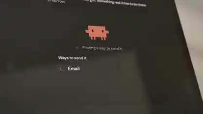

<!-- Generated by scripts/build.py. -->

# The Fable of Clawd

[Back to collection](https://github.com/VibeClip/awesome-fable-5-2-videos/blob/main/README.md)

**[▶ Watch](https://video.twimg.com/amplify_video/2121634141472997376/vid/avc1/3840x2160/ad8dwsaeRrRDLc6w.mp4?tag=29)** · [Original post](https://x.com/rileybrown/status/2121642720045261185)

[rileybrown](https://x.com/rileybrown) · 2:19 · 2026-11-14

The creator credits Fable 5.2 for writing Python to build and animate the Blender sets and characters. Clawd, Pip and a toy truck feature in a story that moves between a study, a workshop and outdoor sets.

[Original post](https://x.com/rileybrown/status/2121643018117841275)

## Shared prompt

No public prompt recorded.

Sources & verification

- Model evidence: Model named in original post
- Post availability checked: 2026-11-15 — Post available

Source availability and video generation are separate checks. Generation and rendering were not independently reproduced.

[License & media rights](https://github.com/VibeClip/awesome-fable-5-2-videos/blob/main/docs/MEDIA-RIGHTS.md)

