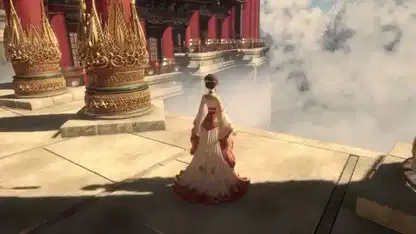

<!-- Generated by scripts/build.py. -->

# Astral Realm, a journey through temples above the clouds

[Back to collection](https://github.com/VibeClip/awesome-fable-5-2-videos/blob/main/README.md)

**[▶ Watch](https://video.twimg.com/amplify_video/2121157447360348161/vid/avc1/3840x2160/b-rzsR5rtkFuWvip.mp4?tag=29)** · [Original post](https://x.com/scottstts/status/2121262812228141395)

[scottstts](https://x.com/scottstts) · 2:00 · 2026-11-13

The creator credits Fable 5.2 and Three.js and says everything apart from the character is procedural.

[Original post](https://x.com/scottstts/status/2121272406241120521)

## Shared prompt

No public prompt recorded.

Sources & verification

- Model evidence: Model named in original post
- Post availability checked: 2026-11-14 — Post available

Source availability and video generation are separate checks. Generation and rendering were not independently reproduced.

[License & media rights](https://github.com/VibeClip/awesome-fable-5-2-videos/blob/main/docs/MEDIA-RIGHTS.md)

