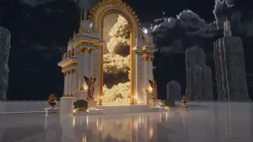

<!-- Generated by scripts/build.py. -->

# Heaven’s Threshold

[Back to collection](https://github.com/VibeClip/awesome-fable-5-2-videos/blob/main/README.md)

**[▶ Watch](https://video.twimg.com/amplify_video/2121888580725325824/vid/avc1/3840x2160/m4Q_EVAAdEgVlKjR.mp4?tag=29)** · [Original post](https://x.com/scottstts/status/2121997403284774933)

[scottstts](https://x.com/scottstts) · 2:00 · 2026-11-15

The creator reports building this 3D environment in Three.js with Fable 5.2 and provides an HDR version in a reply.

[Original post](https://x.com/scottstts/status/2121997403595129298)

## Shared prompt

No public prompt recorded.

Sources & verification

- Model evidence: Model named in original post
- Post availability checked: 2026-11-16 — Post available

Source availability and video generation are separate checks. Generation and rendering were not independently reproduced.

[License & media rights](https://github.com/VibeClip/awesome-fable-5-2-videos/blob/main/docs/MEDIA-RIGHTS.md)

