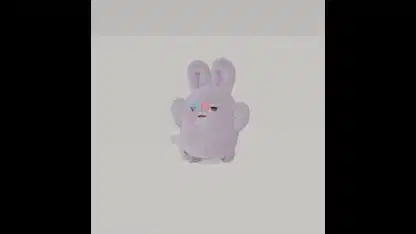

<!-- Generated by scripts/build.py. -->

# A rabbit character in a Blender motion-capture test

[Back to collection](https://github.com/VibeClip/awesome-fable-5-2-videos/blob/main/README.md)

**[▶ Watch](https://video.twimg.com/amplify_video/2121164591338233856/vid/avc1/720x720/VurXACOWrxBzWYhS.mp4?tag=29)** · [Original post](https://x.com/seiiiiiiiiiiru/status/2121164955080917176)

[seiiiiiiiiiiru](https://x.com/seiiiiiiiiiiru) · 0:10 · 2026-11-13

The creator labels the clip a motion-capture test with Fable 5.2 and Blender. The post leaves the capture setup unspecified.

## Shared prompt

No public prompt recorded.

Sources & verification

- Model evidence: Model named in original post
- Post availability checked: 2026-11-13 — Post available

Source availability and video generation are separate checks. Generation and rendering were not independently reproduced.

[License & media rights](https://github.com/VibeClip/awesome-fable-5-2-videos/blob/main/docs/MEDIA-RIGHTS.md)

