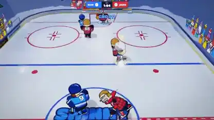

<!-- Generated by scripts/build.py. -->

# A three-on-three arcade pond hockey game

[Back to collection](https://github.com/VibeClip/awesome-fable-5-2-videos/blob/main/README.md)

**[▶ Watch](https://video.twimg.com/amplify_video/2121086832662233088/vid/avc1/1280x720/WoKjs3OOha2AzzCB.mp4?tag=29)** · [Original post](https://x.com/Spidermanzdev/status/2121087583924941302)

[Spidermanzdev](https://x.com/Spidermanzdev) · 0:12 · 2026-11-13

The creator says they built the arcade hockey game with Fable 5.2 and shared this gameplay recording.

## Shared prompt

No public prompt recorded.

Sources & verification

- Model evidence: Model named in original post
- Post availability checked: 2026-11-14 — Post available

Source availability and video generation are separate checks. Generation and rendering were not independently reproduced.

[License & media rights](https://github.com/VibeClip/awesome-fable-5-2-videos/blob/main/docs/MEDIA-RIGHTS.md)

