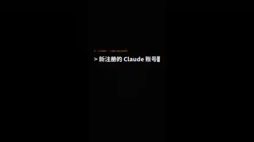

<!-- Generated by scripts/build.py. -->

# A 28-day screenshot diary turned into motion graphics

[Back to collection](https://github.com/VibeClip/awesome-fable-5-2-videos/blob/main/README.md)

**[▶ Watch](https://video.twimg.com/amplify_video/2121618501471219712/vid/avc1/1080x1920/Gk64QZEmZQz7NdJ0.mp4?tag=29)** · [Original post](https://x.com/Stargridcompass/status/2121770161057247242)

[Stargridcompass](https://x.com/Stargridcompass) · 0:28 · 2026-11-15

The creator supplied screenshots from 27 earlier check-ins and asked Fable 5.2 to assemble a closing video for the 28-day series. The edit pairs the screenshots with a running day counter.

## Shared prompt

No public prompt recorded.

Sources & verification

- Model evidence: Model named in original post
- Post availability checked: 2026-11-15 — Post available

Source availability and video generation are separate checks. Generation and rendering were not independently reproduced.

[License & media rights](https://github.com/VibeClip/awesome-fable-5-2-videos/blob/main/docs/MEDIA-RIGHTS.md)

