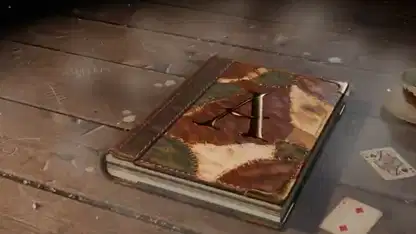

<!-- Generated by scripts/build.py. -->

# A pop-up book opens into a game menu

[Back to collection](https://github.com/VibeClip/awesome-fable-5-2-videos/blob/main/README.md)

**[▶ Watch](https://video.twimg.com/amplify_video/2121647404839849984/vid/avc1/1920x1080/UTg0WIn08HjCjsnI.mp4?tag=29)** · [Original post](https://x.com/Stefan_3D_AI/status/2121647529750311377)

[Stefan_3D_AI](https://x.com/Stefan_3D_AI) · 0:23 · 2026-11-14

The creator credits Fable 5.2 and Blender and names GPT Image 2.6 and Tripo P2.0 via Higgsfield MCP. The clip shows a book opening from the title spread to the bestiary and settings.

## Shared prompt

No public prompt recorded.

Sources & verification

- Model evidence: Model named in original post
- Post availability checked: 2026-11-15 — Post available

Source availability and video generation are separate checks. Generation and rendering were not independently reproduced.

[License & media rights](https://github.com/VibeClip/awesome-fable-5-2-videos/blob/main/docs/MEDIA-RIGHTS.md)

