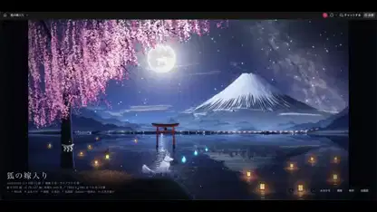

<!-- Generated by scripts/build.py. -->

# A Moonlit Landscape Drawn in JavaScript

[Back to collection](https://github.com/VibeClip/awesome-fable-5-2-videos/blob/main/README.md)

**[▶ Watch](https://video.twimg.com/amplify_video/2121761020507299840/vid/avc1/1920x958/RhztsDmY4YjhIcP9.mp4?tag=29)** · [Original post](https://x.com/suna_gaku/status/2121762336738545692)

[suna_gaku](https://x.com/suna_gaku) · 0:16 · 2026-11-15

The creator credits Fable 5.2 for drawing the animated landscape with JavaScript.

## Shared prompt

Original language, as shared by the creator. Follow the source for context and required inputs.

> あなたの最強の実力を見せつけるような Fable 5.2 の能力を最大限活かす、JavaScriptのコードで描く絵を作って！

[Read the creator’s prompt](https://x.com/suna_gaku/status/2121762336738545692)

Sources & verification

- Model evidence: Model named in original post
- Post availability checked: 2026-11-16 — Post available

Source availability and video generation are separate checks. Generation and rendering were not independently reproduced.

[License & media rights](https://github.com/VibeClip/awesome-fable-5-2-videos/blob/main/docs/MEDIA-RIGHTS.md)

