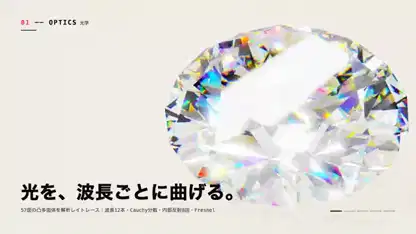

<!-- Generated by scripts/build.py. -->

# Light and Waves, from refraction to interference

[Back to collection](https://github.com/VibeClip/awesome-fable-5-2-videos/blob/main/README.md)

**[▶ Watch](https://video.twimg.com/amplify_video/2120292139250962433/vid/avc1/1280x720/4Eq6Y8beUzyI6wnM.mp4?tag=14)** · [Original post](https://x.com/taka_claudecode/status/2120292244737683687)

[taka_claudecode](https://x.com/taka_claudecode) · 0:38 · 2026-11-10

The creator attributes the visuals and music to Fable 5.2. The chapters include a dispersive gemstone, paths resembling slime mold and particles moving in waves.

## Shared prompt

No public prompt recorded.

Sources & verification

- Model evidence: Model named in original post
- Post availability checked: 2026-11-14 — Post available

Source availability and video generation are separate checks. Generation and rendering were not independently reproduced.

[License & media rights](https://github.com/VibeClip/awesome-fable-5-2-videos/blob/main/docs/MEDIA-RIGHTS.md)

