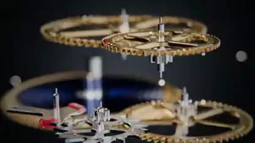

<!-- Generated by scripts/build.py. -->

# A mechanical watch movement in an exploded view

[Back to collection](https://github.com/VibeClip/awesome-fable-5-2-videos/blob/main/README.md)

**[▶ Watch](https://video.twimg.com/amplify_video/2119911154638376960/vid/avc1/1920x1080/W-EtG3d_QCeqJjGK.mp4?tag=29)** · [Original post](https://x.com/techfren/status/2119911343633682916)

[techfren](https://x.com/techfren) · 0:42 · 2026-11-09

The creator says Fable 5.2 built the movement in code. Gears and plates separate into layers before the camera returns to the assembled watch. The post does not name the rendering tool.

## Shared prompt

No public prompt recorded.

Sources & verification

- Model evidence: Model named in original post
- Post availability checked: 2026-11-14 — Post available

Source availability and video generation are separate checks. Generation and rendering were not independently reproduced.

[License & media rights](https://github.com/VibeClip/awesome-fable-5-2-videos/blob/main/docs/MEDIA-RIGHTS.md)

