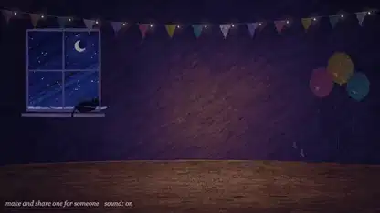

<!-- Generated by scripts/build.py. -->

# A Birthday Card with Candles You Can Blow Out

[Back to collection](https://github.com/VibeClip/awesome-fable-5-2-videos/blob/main/README.md)

**[▶ Watch](https://video.twimg.com/amplify_video/2121810327398645760/vid/avc1/1280x720/IkGXMJrX0wd1gUEF.mp4?tag=14)** · [Original post](https://x.com/Terry_Djony/status/2122313989157687794)

[Terry_Djony](https://x.com/Terry_Djony) · 0:31 · 2026-11-16

The creator credits Fable 5.2 for the interactive card and says its pastel strokes are drawn live in code.

## Shared prompt

No public prompt recorded.

Sources & verification

- Model evidence: Model named in original post
- Post availability checked: 2026-11-16 — Post available

Source availability and video generation are separate checks. Generation and rendering were not independently reproduced.

[License & media rights](https://github.com/VibeClip/awesome-fable-5-2-videos/blob/main/docs/MEDIA-RIGHTS.md)

