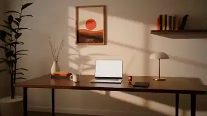

<!-- Generated by scripts/build.py. -->

# Until Dawn, a desk-side story rendered in Blender

[Back to collection](https://github.com/VibeClip/awesome-fable-5-2-videos/blob/main/README.md)

**[▶ Watch](https://video.twimg.com/amplify_video/2120640502261575680/vid/avc1/1280x720/k2KorEXRvxHQV80s.mp4?tag=29)** · [Original post](https://x.com/toumorocorn_00/status/2120640549543936475)

[toumorocorn_00](https://x.com/toumorocorn_00) · 0:59 · 2026-11-11

Inspired by The Edge, the creator made a new film with its own mascot and soundtrack. Fable 5.2 scripted the room, desk and figure in Blender. The creator credits muse and Suno for the music.

## Shared prompt

No public prompt recorded.

Sources & verification

- Model evidence: Model named in original post
- Post availability checked: 2026-11-14 — Post available

Source availability and video generation are separate checks. Generation and rendering were not independently reproduced.

[License & media rights](https://github.com/VibeClip/awesome-fable-5-2-videos/blob/main/docs/MEDIA-RIGHTS.md)

