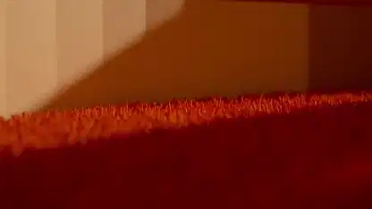

<!-- Generated by scripts/build.py. -->

# An Interior Study in Amber Light

[Back to collection](https://github.com/VibeClip/awesome-fable-5-2-videos/blob/main/README.md)

**[▶ Watch](https://video.twimg.com/amplify_video/2121100838227841024/vid/avc1/1920x1080/XQKlR2Wry89HJEpH.mp4?tag=29)** · [Original post](https://x.com/untitled_sys/status/2121106939094741255)

[untitled_sys](https://x.com/untitled_sys) · 0:20 · 2026-11-13

The creator identifies this as a Fable 5.2 experiment. The renderer and asset workflow are unspecified.

## Shared prompt

No public prompt recorded.

Sources & verification

- Model evidence: Model named in original post
- Post availability checked: 2026-11-16 — Post available

Source availability and video generation are separate checks. Generation and rendering were not independently reproduced.

[License & media rights](https://github.com/VibeClip/awesome-fable-5-2-videos/blob/main/docs/MEDIA-RIGHTS.md)

