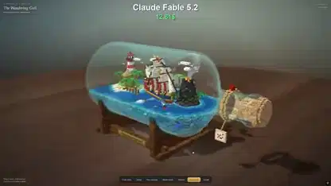

<!-- Generated by scripts/build.py. -->

# A miniature voxel world inside a bottle

[Back to collection](https://github.com/VibeClip/awesome-fable-5-2-videos/blob/main/README.md)

**[▶ Watch](https://video.twimg.com/amplify_video/2120104433254068225/vid/avc1/1920x1080/TwqTpSJ125nfAGeC.mp4?tag=29)** · [Original post](https://x.com/vib3coded/status/2120104517282775514)

[vib3coded](https://x.com/vib3coded) · 0:17 · 2026-11-10

The creator credits Fable 5.2 for the voxel scene shown in the recording.

## Shared prompt

No public prompt recorded.

Sources & verification

- Model evidence: Model named in original post
- Post availability checked: 2026-11-13 — Post available

Source availability and video generation are separate checks. Generation and rendering were not independently reproduced.

[License & media rights](https://github.com/VibeClip/awesome-fable-5-2-videos/blob/main/docs/MEDIA-RIGHTS.md)

